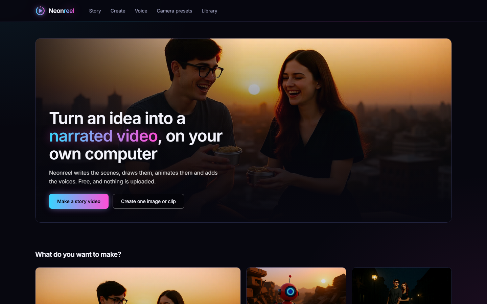
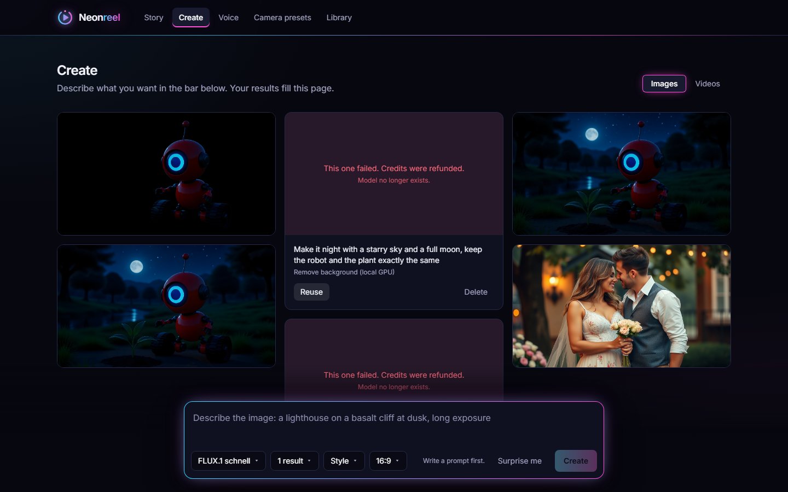
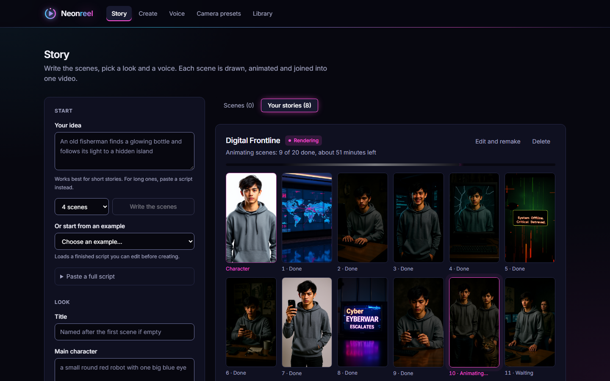
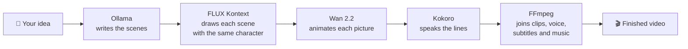

<div align="center">

# 🎬 Neonreel

### Your own AI film studio. On your own computer. Free.

Type an idea. Get images, video clips, and full narrated story videos,
all generated on your graphics card. No subscription, no credits, no uploads.


*This clip was generated by Neonreel on a laptop.*

</div>

---

## ✨ What it does

| | Feature | What you get |
|---|---|---|
| 📖 | **Story mode** | Write one idea or paste a script. Neonreel writes the scenes, draws them, animates them, adds voices and subtitles, and joins everything into one video of up to 20 scenes. |
| 🧑‍🤝‍🧑 | **Consistent characters** | The same person (or couple) in every scene, drawn from one reference picture. Use a generated character or your own photo. |
| 🖼️ | **Images** | Text to image in about 25 seconds, with 11 one-click styles: Cinematic, Anime, Neon noir, Watercolour, Pixel art and more. |
| 🎥 | **Video** | Turn any picture into a moving clip, with 12 camera moves: dolly, orbit, crane, crash zoom, handheld and others. |
| ✏️ | **Edit with words** | "Make it night." "Add falling snow." The picture changes, everything else stays. |
| 🗣️ | **Voices** | 13 voices in 6 languages. Dialogue gets a different voice per speaker: `He:`, `She:`, `Child:`, `Narrator:`. |
| 🎵 | **Finishing** | Burned-in subtitles, fades between scenes, your own background music. |
| 🛠️ | **Clip tools** | Extend +5s, Smooth motion (48 fps), Loop, Reverse, Slow motion. |
| 🔍 | **Picture tools** | Upscale 2x, Remove background. |
| 💡 | **Prompt help** | "Improve prompt" rewrites your idea with more detail. "Surprise me" gives you one to start from. |
| 📚 | **Library** | Everything you made, with search, filters and favourites. |

## 📸 Screenshots

| Home | Create | Story |
|---|---|---|
|  |  |  |

## 🧠 How a story is made



A timer on the server moves each story forward, so rendering continues even
with the browser closed. A 20-scene story with voices took about 48 minutes on
the test laptop.

## ⚠️ Before you install

- **You need an NVIDIA graphics card with about 16 GB of memory.** Neonreel was
  built and tested on one machine: an RTX 5080 laptop running Windows 11.
- **The model files are about 40 GB**, downloaded separately into ComfyUI.
- The one-click launcher is Windows only. On other systems start ComfyUI
  yourself, then run `npm install`, `npm run build` and `npm start`.
- Without a graphics card the app opens, but only the two demo models and the
  Loop, Reverse and Slow motion tools work.

## 🚀 Start it

```
git clone https://github.com/sabrine0/neonreel.git
cd neonreel
```

Then double-click **Start Neonreel.cmd**. It starts ComfyUI if it is not
running, builds the app the first time, and opens http://localhost:4000.

After changing the code, rebuild once: `pwsh -File start.ps1 -Rebuild`.
For development with live reload: `npm run dev`.

## 📦 What it needs

| Need | Used for | Where |
|---|---|---|
| Node.js 22+ | the app | on PATH |
| FFmpeg | joining clips, mixing voice, subtitles, clip tools | on PATH |
| NVIDIA GPU, 16 GB tested | all real image and video generation | |
| ComfyUI | runs the models | `%USERPROFILE%\ComfyUI`, port 8188 |
| Ollama (optional) | "Write the scenes", "Improve prompt" | port 11434, any chat model |
| Python 3.12 (optional) | the voice | `.tts` folder, see below |

### Model files (in `ComfyUI/models`)

| File | Folder | For |
|---|---|---|
| `flux1-schnell-fp8.safetensors` | `checkpoints` | images |
| `wan2.2_ti2v_5B_fp16.safetensors` | `diffusion_models` | video |
| `umt5_xxl_fp8_e4m3fn_scaled.safetensors` | `text_encoders` | video |
| `wan2.2_vae.safetensors` | `vae` | video |
| `Wan2_2_5B_FastWanFullAttn_lora_rank_128_bf16.safetensors` | `loras` | fast video, Extend |
| `flux1-dev-kontext_fp8_scaled.safetensors` | `diffusion_models` | consistent characters, Edit |
| `clip_l.safetensors`, `t5xxl_fp8_e4m3fn_scaled.safetensors` | `text_encoders` | consistent characters, Edit |
| `ae.safetensors` | `vae` | consistent characters, Edit |
| `RealESRGAN_x4plus.safetensors` | `upscale_models` | Upscale 2x |
| `birefnet.safetensors` | `background_removal` | Remove background |
| `film_net_fp16.safetensors` | `frame_interpolation` | Smooth motion |

### Voice (optional)

```
python -m venv .tts
.tts\Scripts\python -m pip install kokoro-onnx soundfile
```

Then put `kokoro-v1.0.onnx` and `voices-v1.0.bin` (from the kokoro-onnx
releases page) in `.tts\models`.

## 🎮 Using it

- **Story**: write or paste the scenes, describe the main character, pick a
  voice, press Create. A finished story can have single scenes remade with
  "Redo scene".
- **Create**: one image, or one clip from a picture with a camera move. Hover a
  result for Reuse, Animate, Edit, Upscale 2x, Remove background. Pick a look
  with Style, or press "Surprise me" for an idea.
- **Clip tools** (under each video): Extend +5s continues the clip from its last
  frame, Smooth motion doubles the frame rate, Loop, Reverse and Slow motion
  need no graphics card.
- **Voice**: text to speech as an MP3, with several voices for dialogue.
- **Library**: everything made so far.

### Script format

Paste into the idea box or "Paste a full script". One scene per line:

```
Title: The Last Spring
Character: a young man with round glasses and a young woman with auburn hair
Style: cinematic 35mm film, soft natural light
1. The couple meet in an empty street || He: You are the first person I have seen. She: Then stay.
2. ~ A nurse lifts a newborn from a cradle || The child lived. No one understood why.
```

- `picture || voice`: what is seen, then what is heard.
- `He:` `She:` `Child:` `Narrator:` give each speaker a different voice. No tag means the narrator.
- A leading `~` marks a scene the main character is not in.
- About 11 spoken words fit a 5-second scene. Longer lines are sped up, then cut.

A full 20-scene example is in `stories/love-story.txt`.

## 🏗️ How it is built

| Layer | Tech |
|---|---|
| App | Next.js 16 (App Router), React 19, TypeScript, Tailwind CSS v4 |
| Images | FLUX.1 schnell, FLUX.1 Kontext dev |
| Video | Wan 2.2 TI2V 5B, with the FastWan LoRA for 4-step rendering |
| Tools | Real-ESRGAN, BiRefNet, FILM frame interpolation |
| Voice | Kokoro TTS |
| Scene writing | any Ollama chat model |
| Assembly | FFmpeg |

- `src/lib/catalog.ts`: models, camera presets, styles, voices. Add a model here.
- `src/lib/providers/`: one file per backend (`comfy`, `ffmpeg`, `fal`, `mock`).
- `src/lib/stories.ts`: the story pipeline.
- `src/lib/render.ts`: FFmpeg joining, voice mixing, subtitles.
- `src/components/ui.tsx` and `src/app/globals.css`: the design system.
- `.data/`: the library (one JSON file plus media). Single user, no login.

## 🚧 Limits

- One user, no accounts. Do not expose it to the internet as it is.
- One main character (or one couple) is kept consistent per story.
- Voices are voice-over: mouths do not move with the words.
- Experimental: the hosted option (fal.ai, `FAL_KEY` in `.env.local`) is
  written but has never been run against the real service.
- The layout is made for a desktop screen. Phones have not been tested.
- There are no automated tests yet.

## 📄 Licence

The code is under the MIT licence (see `LICENSE`). The models are not part of
this repository and keep their own licences: FLUX.1 Kontext [dev] in particular
is for non-commercial use only.

---

<div align="center">

If Neonreel is useful to you, a ⭐ on the repository helps other people find it.

</div>
