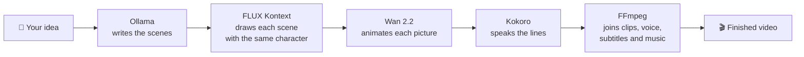

<div align="center">

# 🎬 Neonreel

### Your own AI film studio. On your own computer. Free.

Type an idea. Get images, video clips, and full narrated story videos,
all generated on your graphics card. No subscription, no credits, no uploads.


*This clip was generated by Neonreel on a laptop.*

</div>

---

## ✨ What it does

| | Feature | What you get |
|---|---|---|
| 📖 | **Story mode** | Write one idea or paste a script. Neonreel writes the scenes, draws them, animates them, adds voices and subtitles, and joins everything into one video of up to 20 scenes. |
| 🧑‍🤝‍🧑 | **Consistent characters** | The same person (or couple) in every scene, drawn from one reference picture. Use a generated character or your own photo. |
| 🖼️ | **Images** | Text to image in about 25 seconds, with 11 one-click styles: Cinematic, Anime, Neon noir, Watercolour, Pixel art and more. |
| 🎥 | **Video** | Turn any picture into a moving clip, with 12 camera moves: dolly, orbit, crane, crash zoom, handheld and others. |
| ✏️ | **Edit with words** | "Make it night." "Add falling snow." The picture changes, everything else stays. |
| 🗣️ | **Voices** | 13 voices in 6 languages. Dialogue gets a different voice per speaker: `He:`, `She:`, `Child:`, `Narrator:`. |
| 🎵 | **Finishing** | Burned-in subtitles, fades between scenes, your own background music. |
| 🛠️ | **Clip tools** | Extend +5s, Smooth motion (48 fps), Loop, Reverse, Slow motion. |
| 🔍 | **Picture tools** | Upscale 2x, Remove background. |
| 💡 | **Prompt help** | "Improve prompt" rewrites your idea with more detail. "Surprise me" gives you one to start from. |
| 🤖 | **Assistant** | Chat in your own words: "make a 4-scene story about a robot who learns to paint". A local language model starts the work. |
| 🔌 | **AI connector (MCP)** | Let any AI app that speaks MCP create pictures, clips and stories in Neonreel. |
| 📲 | **Share** | One click resizes a video for TikTok, Instagram Reels, YouTube Shorts, YouTube or X, writes a caption with hashtags, and opens the upload page. |
| 🖥️ | **Desktop window** | Run it as its own app window instead of a browser tab. |
| 📚 | **Library** | Everything you made, with search, filters and favourites. |

## 📸 Screenshots

| Home | Create | Story |
|---|---|---|
|  |  |  |

## 🧠 How a story is made



A timer on the server moves each story forward, so rendering continues even
with the browser closed. A 20-scene story with voices took about 48 minutes on
the test laptop.

## ⚠️ Before you install

- **You need an NVIDIA graphics card with about 16 GB of memory.** Neonreel was
  built and tested on one machine: an RTX 5080 laptop running Windows 11.
- **The model files are about 55 GB.** The setup downloads them for you.
- The setup and launcher are for Windows. On other systems follow the manual
  steps at the end of this section.
- Without a graphics card the app opens, but only the two demo models and the
  Loop, Reverse and Slow motion tools work.

## 🚀 Install and start

```
git clone https://github.com/sabrine0/neonreel.git
cd neonreel
```

1. Double-click **Setup Neonreel.cmd**, once. It checks for Git, Python,
   Node.js and FFmpeg (and offers to install missing ones), installs the app,
   installs ComfyUI, downloads every model file and the voice files, and sets
   up Ollama with a small language model. It can be run again at any time:
   finished steps are skipped and stopped downloads resume.
2. Double-click **Start Neonreel.cmd**. It starts ComfyUI if it is not running
   and opens http://localhost:4000.

Short on disk or time? `powershell -File setup.ps1 -ModelFilter flux` downloads
only the picture model (17 GB); `-SkipModels`, `-SkipComfy` and `-SkipOllama`
skip those parts.

### As a desktop window

Double-click **Neonreel Desktop.cmd**, or run `npm run desktop`. It opens
Neonreel in its own window and starts the server and ComfyUI if needed. It runs
from this folder; there is no installer yet.

### Connect an AI app (MCP)

While Neonreel is running, any app that speaks the Model Context Protocol can
use it. Point the app at:

```
http://localhost:4000/api/mcp
```

Tools: `create_image`, `create_video`, `create_story`, `list_library`,
`get_status`. The endpoint only answers programs on this computer.

### By hand (macOS, Linux, or if you prefer)

```
python -m venv .venv
.venv/bin/pip install -r backend/requirements.txt kokoro-onnx soundfile
cd frontend && npm install && npm run build && cd ..
.venv/bin/python -m uvicorn neonreel.main:app --app-dir backend --port 4000
```

Start ComfyUI yourself on port 8188 and put the files listed in
`tools/models.json` into its `models` folders. This path has not been tested
outside Windows.

## 📦 What it needs

| Need | Used for | Where |
|---|---|---|
| Python 3.10+ | the server and the voice | on PATH |
| Node.js 20+ | building the interface, the desktop window | on PATH |
| FFmpeg | joining clips, mixing voice, subtitles, clip tools | on PATH |
| NVIDIA GPU, 16 GB tested | all real image and video generation | |
| ComfyUI | runs the models | `%USERPROFILE%\ComfyUI`, port 8188 |
| Ollama (optional) | "Write the scenes", "Improve prompt", Assistant, captions | port 11434, any chat model |

### Model files (in `ComfyUI/models`)

The setup downloads these. The exact addresses are in `tools/models.json`.

| File | Folder | For |
|---|---|---|
| `flux1-schnell-fp8.safetensors` | `checkpoints` | images |
| `wan2.2_ti2v_5B_fp16.safetensors` | `diffusion_models` | video |
| `umt5_xxl_fp8_e4m3fn_scaled.safetensors` | `text_encoders` | video |
| `wan2.2_vae.safetensors` | `vae` | video |
| `Wan2_2_5B_FastWanFullAttn_lora_rank_128_bf16.safetensors` | `loras` | fast video, Extend |
| `flux1-dev-kontext_fp8_scaled.safetensors` | `diffusion_models` | consistent characters, Edit |
| `clip_l.safetensors`, `t5xxl_fp8_e4m3fn_scaled.safetensors` | `text_encoders` | consistent characters, Edit |
| `ae.safetensors` | `vae` | consistent characters, Edit |
| `RealESRGAN_x4plus.safetensors` | `upscale_models` | Upscale 2x |
| `birefnet.safetensors` | `background_removal` | Remove background |
| `film_net_fp16.safetensors` | `frame_interpolation` | Smooth motion |

### Voice

The setup installs the Kokoro voice engine and puts `kokoro-v1.0.onnx` and
`voices-v1.0.bin` in `.tts/models`.

## 🎮 Using it

- **Story**: write or paste the scenes, describe the main character, pick a
  voice, press Create. A finished story can have single scenes remade with
  "Redo scene".
- **Create**: one image, or one clip from a picture with a camera move. Hover a
  result for Reuse, Animate, Edit, Upscale 2x, Remove background. Pick a look
  with Style, or press "Surprise me" for an idea.
- **Clip tools** (under each video): Extend +5s continues the clip from its last
  frame, Smooth motion doubles the frame rate, Loop, Reverse and Slow motion
  need no graphics card.
- **Assistant**: chat with the local language model (needs Ollama). It is a
  small model: it sometimes misunderstands or answers in the wrong language.
- **Share** (under each video and finished story): choose a platform, press
  Prepare, then download the video, copy the caption and open the upload page.
  You post it yourself; Neonreel never connects to your accounts.
- **Voice**: text to speech as an MP3, with several voices for dialogue.
- **Library**: everything made so far.

### Script format

Paste into the idea box or "Paste a full script". One scene per line:

```
Title: The Last Spring
Character: a young man with round glasses and a young woman with auburn hair
Style: cinematic 35mm film, soft natural light
1. The couple meet in an empty street || He: You are the first person I have seen. She: Then stay.
2. ~ A nurse lifts a newborn from a cradle || The child lived. No one understood why.
```

- `picture || voice`: what is seen, then what is heard.
- `He:` `She:` `Child:` `Narrator:` give each speaker a different voice. No tag means the narrator.
- A leading `~` marks a scene the main character is not in.
- About 11 spoken words fit a 5-second scene. Longer lines are sped up, then cut.

A full 20-scene example is in `stories/love-story.txt`.

## 🏗️ How it is built

| Layer | Tech |
|---|---|
| Server | Python, FastAPI, httpx |
| Interface | React 19, Vite, TypeScript, Tailwind CSS v4, React Router |
| Desktop window | Electron |
| Images | FLUX.1 schnell, FLUX.1 Kontext dev |
| Video | Wan 2.2 TI2V 5B, with the FastWan LoRA for 4-step rendering |
| Tools | Real-ESRGAN, BiRefNet, FILM frame interpolation |
| Voice | Kokoro TTS |
| Scene writing | any Ollama chat model |
| Assembly | FFmpeg |

```
backend/neonreel/      the server
  main.py              every /api route, and serving the built interface
  catalog.py           models, camera moves, voices, looks
  generations.py       single pictures and clips
  stories.py           the story pipeline (stills, clips, join)
  render.py, clip.py   FFmpeg: joining, voice mixing, subtitles, clip tools
  writer.py            what the language model writes: scenes, prompts, captions
  agent.py             the tools shared by the Assistant and the MCP endpoint
  providers/           one file per backend: comfy, ffmpeg, fal, mock
frontend/src/          the interface
  pages/               one file per screen
  components/          the screens' parts; ui.tsx is the design system
  lib/catalog.ts       the interface's copy of the catalog
desktop/               the Electron window
tools/                 the voice script and the list of model downloads
.data/                 your library (one JSON file plus media). Single user, no login.
```

To work on the interface with live reload: start the server, then run
`npm run dev` in `frontend/` and open http://localhost:5173.

Adding a model means adding it in two places: `backend/neonreel/catalog.py`
and `frontend/src/lib/catalog.ts`.

## 🚧 Limits

- One user, no accounts. Do not expose it to the internet as it is.
- One main character (or one couple) is kept consistent per story.
- Voices are voice-over: mouths do not move with the words.
- Experimental: the hosted option (fal.ai, `FAL_KEY` in `.env.local`) is
  written but has never been run against the real service.
- The setup script has been run in parts on one computer, never from zero on a
  clean one.
- The layout is made for a desktop screen. Phones have not been tested.
- There are no automated tests yet.

## 📄 Licence

The code is under the MIT licence (see `LICENSE`). The models are not part of
this repository and keep their own licences: FLUX.1 Kontext [dev] in particular
is for non-commercial use only.

---

<div align="center">

If Neonreel is useful to you, a ⭐ on the repository helps other people find it.

Made by [sabrine0](https://github.com/sabrine0)

</div>
